<div align="center">

<picture>
  <source media="(prefers-color-scheme: dark)" srcset="assets/banner.svg">
  <source media="(prefers-color-scheme: light)" srcset="assets/banner-light.svg">
  
</picture>

[](LICENSE)
[](#설치)
[](#설치)
[](#설치)
[](https://uniqai.app/?utm_source=github&utm_medium=readme-ko&utm_campaign=awesome-ai-video-prompts)

**Kling 3.0, Veo 3, Wan 2.5, Runway, Seedance용 엄선된 AI 영상 프롬프트. 모델, 설정, 그리고 각 프롬프트가 통하는 이유까지 함께 적었습니다.**

[빠른 시작](#빠른-시작) · [프롬프트 목록](#프롬프트-목록) · [작동 방식](#작동-방식) · [예시](#예시) · [설치](#설치) · [FAQ](#faq)

</div>

[English](README.md) · [Русский](README.ru.md) · [简体中文](README.zh-CN.md) · [Español](README.es.md) · [Português (BR)](README.pt-BR.md) · [日本語](README.ja.md) · 한국어

# Awesome AI Video Prompts: AI 영상 프롬프트 모음, Kling 3.0, Veo 3, Wan, Runway, Seedance

Kling 3.0, Veo 3, Wan 2.5, Runway Gen-4, Seedance 2.x용 AI 영상 프롬프트(텍스트에서 영상, 이미지에서 영상)를 엄선한 목록이며, Flux, Nano Banana, GPT Image용 이미지 프롬프트도 소수 포함되어 있습니다. 모든 항목에는 코드 블록 안의 프롬프트, 대상 모델, 모드, 길이, 화면 비율, 그 구조가 통하는 이유에 대한 메모, 그리고 누군가 실제 렌더링을 보고하기 전까지 비어 있는 `rendered_on` 필드가 있습니다. 데이터는 JSON이고, Markdown 페이지와 아래 수치는 거기서 생성됩니다.

| **범용이 아닌 모델별** | **결과에 솔직함** | **에이전트 스킬로 동작** |
|:---|:---|:---|
| 모든 프롬프트는 제조사 자체 가이드(날짜와 함께 인용)를 따릅니다. Kling은 카메라 무브 하나만, Veo는 오디오를 별도 문장으로, Seedance는 라벨이 붙은 샷으로. | "작성 대상"과 "렌더링한 모델"은 별개의 필드입니다. 이 README의 수치는 키보드가 아니라 `scripts/stats.py`에서 나옵니다. | `SKILL.md` 덕분에 Claude Code, Cursor, Codex가 목록을 검색하고 가장 가까운 프롬프트를 원하는 샷에 맞게 고칠 수 있습니다. |

## 빠른 시작

```bash
git clone https://github.com/uniqaiapp/awesome-ai-video-prompts
cd awesome-ai-video-prompts
python3 scripts/find.py --model kling-3 --use-case product
```

조건에 맞는 프롬프트가 텍스트로 출력되며, 각각 `Why it works` 한 줄과 렌더링 보고 여부가 붙습니다. 설치할 패키지는 없고, Python 3.9+가 필요합니다. 터미널 없이 보려면 [모델별](prompts/by-model/) 또는 [용도별](prompts/by-use-case/)로 가십시오.

## 데모



## 목록에 담긴 것

<!-- generated:stats:start -->
| 모델 | 해당 모델용 프롬프트 수 |
|:---|---:|
| Kling 3.0 (`kling-3`) | 32 |
| Veo 3 (`veo-3`) | 7 |
| Wan 2.5 (`wan-2.5`) | 12 |
| Runway Gen-4 family (`runway-gen-4`) | 3 |
| Seedance 2.x (`seedance-2`) | 6 |
| Flux (`flux`) | 6 |
| Nano Banana (Gemini image) (`nano-banana`) | 8 |
| GPT Image (`gpt-image`) | 8 |

| 용도 | 프롬프트 수 |
|:---|---:|
| 카메라 무브 | 9 |
| 제품 | 6 |
| 인물 | 5 |
| 자연 | 5 |
| 액션 | 5 |
| 광고 | 4 |
| 애니메이션 | 4 |
| 이미지를 영상으로 | 6 |
| 정지 이미지(이미지 프롬프트) | 8 |

| 모드 | 프롬프트 수 |
|:---|---:|
| 텍스트에서 영상 (`t2v`) | 38 |
| 이미지에서 영상 (`i2v`) | 6 |
| 텍스트에서 이미지 (`t2i`) | 6 |
| 이미지 편집 (`i2i`) | 2 |

총 52개 프롬프트: 영상 44개, 이미지 8개. 7개는 렌더링 보고가 있고(`rendered_on`이 비어 있지 않음), 45개는 제조사 프롬프트 가이드 또는 UniqAI 라이브러리를 따르지만 아직 렌더링 보고가 없습니다.
<!-- generated:stats:end -->

## 프롬프트 목록

프롬프트당 한 줄입니다. 링크를 열면 프롬프트 본문, 통하는 이유 메모, 있다면 렌더링 보고까지 담긴 전체 항목이 나옵니다. 모델 키: `kling-3` Kling 3.0, `veo-3` Veo 3, `wan-2.5` Wan 2.5, `runway-gen-4` Runway Gen-4 계열, `seedance-2` Seedance 2.x, `flux`, `nano-banana`, `gpt-image`. 모드: `t2v` 텍스트에서 영상, `i2v` 이미지에서 영상, `t2i` 텍스트에서 이미지, `i2i` 이미지 편집.

<!-- generated:list:start -->
### 카메라 무브

- [Brass compass, push in](prompts/by-use-case/camera-moves.md#brass-compass-push-in) · kling-3 · `t2v` · 5 s
- [Lit candle, pull back](prompts/by-use-case/camera-moves.md#lit-candle-pull-back) · kling-3 · `t2v` · 5 s
- [Harbour boats, pan left](prompts/by-use-case/camera-moves.md#harbour-boats-pan-left) · kling-3 · `t2v` · 5 s
- [Hiker on a ridge, tilt up](prompts/by-use-case/camera-moves.md#hiker-on-a-ridge-tilt-up) · kling-3 · `t2v` · 5 s
- [Bronze horse, orbit](prompts/by-use-case/camera-moves.md#bronze-horse-orbit) · kling-3 · `t2v` · 5 s
- [Lighthouse at dusk, dolly in with sound](prompts/by-use-case/camera-moves.md#lighthouse-at-dusk-dolly-in-with-sound) · veo-3 · `t2v` · 8 s
- [Old town rooftops, crane up](prompts/by-use-case/camera-moves.md#old-town-rooftops-crane-up) · wan-2.5, kling-3 · `t2v` · 5 s
- [Handheld follow through a corridor](prompts/by-use-case/camera-moves.md#handheld-follow-through-a-corridor) · runway-gen-4, seedance-2 · `t2v` · 5 s
- [Chrome droplet over a neon street, push in](prompts/by-use-case/camera-moves.md#chrome-droplet-over-a-neon-street-push-in) · kling-3 · `t2v` · 8 s

[「카메라 무브」 프롬프트 전체 보기(전문 포함) →](prompts/by-use-case/camera-moves.md)

### 제품

- [Headphones on a turntable](prompts/by-use-case/product.md#headphones-on-a-turntable) · kling-3 · `t2v` · 5 s
- [Perfume bottle, macro water drop](prompts/by-use-case/product.md#perfume-bottle-macro-water-drop) · kling-3 · `t2v` · 5 s
- [Sneaker, quarter orbit](prompts/by-use-case/product.md#sneaker-quarter-orbit) · kling-3 · `t2v` · 5 s
- [Coffee pour, slow motion with sound](prompts/by-use-case/product.md#coffee-pour-slow-motion-with-sound) · veo-3 · `t2v` · 8 s
- [Watch, two connected shots](prompts/by-use-case/product.md#watch-two-connected-shots) · seedance-2 · `t2v` · 10 s
- [Skincare jar, slow rotate on marble](prompts/by-use-case/product.md#skincare-jar-slow-rotate-on-marble) · kling-3, wan-2.5 · `t2v` · 5 s

[「제품」 프롬프트 전체 보기(전문 포함) →](prompts/by-use-case/product.md)

### 인물

- [Studio portrait, blink and smile](prompts/by-use-case/portrait.md#studio-portrait-blink-and-smile) · kling-3 · `t2v` · 5 s
- [Golden hour, push in to close-up](prompts/by-use-case/portrait.md#golden-hour-push-in-to-close-up) · kling-3 · `t2v` · 5 s
- [Dancer, track forward](prompts/by-use-case/portrait.md#dancer-track-forward) · kling-3 · `t2v` · 5 s
- [Portrait with one line of dialogue](prompts/by-use-case/portrait.md#portrait-with-one-line-of-dialogue) · veo-3 · `t2v` · 8 s
- [Rain on a window, portrait behind it](prompts/by-use-case/portrait.md#rain-on-a-window-portrait-behind-it) · wan-2.5, kling-3 · `t2v` · 5 s

[「인물」 프롬프트 전체 보기(전문 포함) →](prompts/by-use-case/portrait.md)

### 자연

- [Mountain lake at sunrise, static wide](prompts/by-use-case/nature.md#mountain-lake-at-sunrise-static-wide) · kling-3 · `t2v` · 5 s
- [Coastal dune, tilt down](prompts/by-use-case/nature.md#coastal-dune-tilt-down) · kling-3 · `t2v` · 5 s
- [Autumn pond, push in](prompts/by-use-case/nature.md#autumn-pond-push-in) · kling-3 · `t2v` · 5 s
- [Thunderstorm over a plain, with sound](prompts/by-use-case/nature.md#thunderstorm-over-a-plain-with-sound) · veo-3 · `t2v` · 8 s
- [Tide pool, macro](prompts/by-use-case/nature.md#tide-pool-macro) · wan-2.5, kling-3 · `t2v` · 5 s

[「자연」 프롬프트 전체 보기(전문 포함) →](prompts/by-use-case/nature.md)

### 액션

- [Cyclist in the rain, tracking shot](prompts/by-use-case/action.md#cyclist-in-the-rain-tracking-shot) · kling-3 · `t2v` · 5 s
- [Wok flame, static camera](prompts/by-use-case/action.md#wok-flame-static-camera) · kling-3 · `t2v` · 5 s
- [Skateboarder, low-angle pass](prompts/by-use-case/action.md#skateboarder-low-angle-pass) · runway-gen-4, seedance-2 · `t2v` · 5 s
- [Alley chase, two connected shots](prompts/by-use-case/action.md#alley-chase-two-connected-shots) · seedance-2 · `t2v` · 10 s
- [Horse galloping on a beach, side tracking](prompts/by-use-case/action.md#horse-galloping-on-a-beach-side-tracking) · wan-2.5, kling-3, veo-3 · `t2v` · 5 s

[「액션」 프롬프트 전체 보기(전문 포함) →](prompts/by-use-case/action.md)

### 광고

- [UGC-style handheld product talk, with disclosure](prompts/by-use-case/ads.md#ugc-style-handheld-product-talk-with-disclosure) · veo-3 · `t2v` · 8 s
- [Vertical product hero reveal](prompts/by-use-case/ads.md#vertical-product-hero-reveal) · kling-3, wan-2.5 · `t2v` · 5 s
- [App promo, three beats](prompts/by-use-case/ads.md#app-promo-three-beats) · seedance-2 · `t2v` · 10 s
- [Fabric in slow motion, space left for a logo](prompts/by-use-case/ads.md#fabric-in-slow-motion-space-left-for-a-logo) · runway-gen-4, kling-3, wan-2.5 · `t2v` · 5 s

[「광고」 프롬프트 전체 보기(전문 포함) →](prompts/by-use-case/ads.md)

### 애니메이션

- [Anime rooftop, wind and hair](prompts/by-use-case/anime.md#anime-rooftop-wind-and-hair) · wan-2.5, kling-3 · `t2v` · 5 s
- [Anime rain street, slow pan](prompts/by-use-case/anime.md#anime-rain-street-slow-pan) · kling-3, wan-2.5 · `t2v` · 5 s
- [Anime two-shot, reaction without dialogue](prompts/by-use-case/anime.md#anime-two-shot-reaction-without-dialogue) · seedance-2 · `t2v` · 10 s
- [Mecha hangar, tilt up](prompts/by-use-case/anime.md#mecha-hangar-tilt-up) · kling-3, wan-2.5 · `t2v` · 5 s

[「애니메이션」 프롬프트 전체 보기(전문 포함) →](prompts/by-use-case/anime.md)

### 이미지를 영상으로

- [Portrait photo: blink and breeze](prompts/by-use-case/image-to-video.md#portrait-photo-blink-and-breeze) · kling-3 · `i2v` · 5 s
- [Table or still-life photo: steam and flame](prompts/by-use-case/image-to-video.md#table-or-still-life-photo-steam-and-flame) · kling-3 · `i2v` · 5 s
- [Landscape photo: clouds and ripples, pan](prompts/by-use-case/image-to-video.md#landscape-photo-clouds-and-ripples-pan) · kling-3 · `i2v` · 5 s
- [Illustration: gentle natural motion, keep the style](prompts/by-use-case/image-to-video.md#illustration-gentle-natural-motion-keep-the-style) · kling-3, wan-2.5 · `i2v` · 5 s
- [Product photo: quarter turn with sound](prompts/by-use-case/image-to-video.md#product-photo-quarter-turn-with-sound) · veo-3 · `i2v` · 8 s
- [City photo: traffic and lights come alive](prompts/by-use-case/image-to-video.md#city-photo-traffic-and-lights-come-alive) · wan-2.5, kling-3 · `i2v` · 5 s

[「이미지를 영상으로」 프롬프트 전체 보기(전문 포함) →](prompts/by-use-case/image-to-video.md)

### 정지 이미지(이미지 프롬프트)

- [Catalogue product shot: stoneware teapot](prompts/by-use-case/stills.md#catalogue-product-shot-stoneware-teapot) · nano-banana, flux, gpt-image · `t2i` · 렌더링됨
- [Editorial studio portrait, real skin](prompts/by-use-case/stills.md#editorial-studio-portrait-real-skin) · flux, nano-banana, gpt-image · `t2i` · 렌더링됨
- [Golden-hour field portrait](prompts/by-use-case/stills.md#golden-hour-field-portrait) · flux, nano-banana, gpt-image · `t2i` · 렌더링됨
- [Neon night portrait, anamorphic](prompts/by-use-case/stills.md#neon-night-portrait-anamorphic) · flux, nano-banana, gpt-image · `t2i` · 렌더링됨
- [Black-and-white character study](prompts/by-use-case/stills.md#black-and-white-character-study) · flux, nano-banana, gpt-image · `t2i` · 렌더링됨
- [Edit: enhance a dim phone photo, change nothing else](prompts/by-use-case/stills.md#edit-enhance-a-dim-phone-photo-change-nothing-else) · nano-banana, gpt-image · `i2i` · 렌더링됨
- [Edit: selfie to business headshot, keep the face](prompts/by-use-case/stills.md#edit-selfie-to-business-headshot-keep-the-face) · nano-banana, gpt-image · `i2i`
- [Beauty portrait, freckles kept](prompts/by-use-case/stills.md#beauty-portrait-freckles-kept) · flux, nano-banana, gpt-image · `t2i` · 렌더링됨

[「정지 이미지(이미지 프롬프트)」 프롬프트 전체 보기(전문 포함) →](prompts/by-use-case/stills.md)

### 모델별

- [Kling 3.0](prompts/by-model/kling-3.md) · 32개 프롬프트 · 무음 클립
- [Veo 3](prompts/by-model/veo-3.md) · 7개 프롬프트 · 오디오 생성
- [Wan 2.5](prompts/by-model/wan-2.5.md) · 12개 프롬프트 · 오디오 생성
- [Runway Gen-4 family](prompts/by-model/runway-gen-4.md) · 3개 프롬프트 · 무음 클립
- [Seedance 2.x](prompts/by-model/seedance-2.md) · 6개 프롬프트 · 무음 클립
- [Flux](prompts/by-model/flux.md) · 6개 프롬프트 · 이미지 모델
- [Nano Banana (Gemini image)](prompts/by-model/nano-banana.md) · 8개 프롬프트 · 이미지 모델
- [GPT Image](prompts/by-model/gpt-image.md) · 8개 프롬프트 · 이미지 모델
<!-- generated:list:end -->

## 작동 방식

1. **모든 모델에 하나의 구조.** 피사체와 그 동작 → 배경 → 카메라 무브 하나(또는 "static camera") → 렌즈와 빛 → 분위기. Kuaishou의 Kling 가이드는 정확히 이 순서와 "5초 영상에 적합한" 움직임을 요구하고, Google의 Veo 가이드는 같은 요소를 나열한 뒤 오디오를 별도 문장으로 추가합니다. 순서는 모델마다 같고 문법 세부는 다른데, [`references/model-notes.md`](references/model-notes.md)에 제조사 페이지와 확인 날짜와 함께 정리되어 있습니다.
2. **움직임 하나, 무브 하나.** 모든 영상 프롬프트는 속도와 안정성 단어가 붙은 카메라 무브 하나("slow, stable push in, no sudden motion")와 5~8초 안에 끝나는 피사체 동작 하나만 지정합니다. 부수적인 움직임은 값싸고 연속적인 것에서 옵니다. 머리카락을 흔드는 바람, 김, 떠다니는 먼지, 회전하는 광선.
3. **무엇이 가만히 있는지 말하기.** 네거티브 프롬프트(많은 프런트엔드에서 Kling에는 없습니다) 대신, 항목은 바뀌면 안 되는 것을 명시합니다. "static camera, product centred", 이미지에서 영상이라면 "keep the framing, background and art style exactly as in the photo".
4. **모델이 지원할 때만 오디오와 멀티샷.** Veo 항목은 `Audio: …`와 `No music`으로 끝나고, 대사는 `She says: "…"`를 씁니다. Seedance 항목은 `Shot 1`과 `Shot 2`에 라벨을 붙이고 의상, 렌즈, 빛을 두 샷에서 동일하게 유지합니다.
5. **JSON이 원본입니다.** `data/prompts/<use-case>.json`이 레코드를 담고, `data/schema.json`이 명세이며, `scripts/validate.py`가 이를 검사하고, `scripts/build.py`가 `prompts/**/*.md`와 이 README의 생성 섹션 두 개를 씁니다. 어긋나면 테스트가 실패합니다.

```
data/prompts/*.json  ──validate.py──▶  ok
        │
        └──build.py──▶  prompts/by-model/*.md
                        prompts/by-use-case/*.md
                        README.md (stats + list sections)
```

같은 프롬프트를 Kling 3.0, Veo 3, Wan 2.5에서 나란히 비교하려면 [UniqAI가 하나의 입력창에서 세 모델을 모두 실행합니다](https://uniqai.app/video?utm_source=github&utm_medium=readme-ko&utm_campaign=awesome-ai-video-prompts). 이 모델들을 제공하는 다른 도구도 같은 방식으로 쓸 수 있습니다.

## 예시

<details>
<summary><b>막연한 프롬프트 → 카메라 무브 하나짜리 Kling 3.0 프롬프트</b></summary>

**Before**

```text
A perfume bottle, cinematic, luxury, 4k, slow motion, beautiful lighting.
```

**After** (`kling-perfume-macro-drop`)

```text
A glass bottle of amber perfume standing on wet black slate, a single water drop running down the glass. Slow push in on the bottle. 90 mm macro lens, soft backlight through the liquid, small specular highlights. Elegant, quiet atmosphere.
```

움직임 하나(물방울), 카메라 무브 하나(push in), 렌즈, 빛의 방향, 분위기. "4k"와 "cinematic"은 사라졌습니다. 그것들은 설정과 형용사이지 지시가 아닙니다.

</details>

<details>
<summary><b>Sora 스타일 프롬프트 → 소리가 있는 Veo 3 프롬프트</b></summary>

**Before**

```text
A golden retriever runs along a beach at sunset, cinematic, shallow depth of field.
```

**After**

```text
Tracking shot at ground level: a golden retriever runs along a wet beach at sunset, waves rolling in behind it. Shallow depth of field, warm light. Sound: surf and paws on sand.
```

카메라 무브에 이름이 있고, 움직임이 구체적이며, 소리가 나열되어 있습니다. Sora 프롬프트 옮기기에 대한 더 자세한 내용은 [`references/sora-alternatives.md`](references/sora-alternatives.md)에 있습니다.

</details>

<details>
<summary><b>사진 → 이미지에서 영상 프롬프트</b></summary>

**Before**

```text
Make this photo move.
```

**After** (`kling-i2v-portrait-blink-breeze`)

```text
The person blinks and smiles slightly, hair moving in a light breeze. Static camera.
```

사진의 경우 프롬프트는 움직임만 설명합니다. 피사체, 빛, 구도는 이미 사진에 있습니다. 여기 적은 세 가지 움직임은 얼굴을 망가뜨리지 않는 것들입니다.

</details>

<details>
<summary><b>에이전트에서 사용하기</b></summary>

```text
You: I need a vertical product reveal for earbuds, Kling, 5 seconds.
Agent (with the skill): runs python3 scripts/find.py --use-case ads --model kling-3,
  picks kling-hero-product-reveal-vertical, swaps "earbud case" details for yours,
  returns the prompt in a code block and notes that the source entry has no render report yet.
```

</details>

## 설치

지시 파일을 읽는 모든 에이전트에서 동작합니다. 쓰는 것을 고르십시오.

<details open>
<summary><b>Claude Code</b> (스킬로)</summary>

```bash
git clone https://github.com/uniqaiapp/awesome-ai-video-prompts ~/.claude/skills/awesome-ai-video-prompts
```

그다음 Claude Code에서 `/awesome-ai-video-prompts`를 입력하거나 그냥 작업을 설명하십시오. 스킬 설명이 트리거가 됩니다. 전역 대신 프로젝트 단위로 쓰려면 프로젝트 안의 `.claude/skills/awesome-ai-video-prompts`에 클론하십시오.

uniqaiapp 마켓플레이스가 공개되면 플러그인으로:

```
/plugin marketplace add uniqaiapp/skills
/plugin install awesome-ai-video-prompts@uniqaiapp
```

</details>

<details>
<summary><b>Cursor</b></summary>

`SKILL.md`, `scripts/`, `data/`, `references/`, [`.cursor/rules/awesome-ai-video-prompts.mdc`](.cursor/rules/awesome-ai-video-prompts.mdc)를 프로젝트에 복사하십시오. 규칙 파일에 스킬이 포함되어 있습니다.

</details>

<details>
<summary><b>Codex / AGENTS.md를 읽는 모든 에이전트</b></summary>

`SKILL.md`, `scripts/`, `data/`, `references/`를 `.agents/skills/awesome-ai-video-prompts/`에 복사하고, [`codex/INSTRUCTIONS.md`](codex/INSTRUCTIONS.md)의 스니펫을 `AGENTS.md`에 추가하십시오.

</details>

<details>
<summary><b>에이전트 없이</b></summary>

모든 스크립트는 단독으로 실행됩니다: `python3 scripts/find.py --help`, `python3 scripts/stats.py`, `python3 scripts/validate.py`. 아니면 [`SKILL.md`](SKILL.md)를 아무 모델의 시스템 프롬프트에 붙여넣으십시오. frontmatter 밖에는 특정 에이전트 전용 문법이 없습니다.

</details>

요구 사항: Python 3.9+. 설치할 패키지는 없습니다.

## 한계와 솔직한 설명

- **작성 대상은 렌더링한 모델이 아닙니다.** 대부분의 항목은 `rendered_on`이 비어 있는 상태로 시작합니다. 인용된 제조사 가이드를 따르거나 UniqAI 프롬프트 라이브러리에서 왔는데, 이는 구조에 대한 주장이지 볼 수 있는 클립에 대한 주장이 아닙니다. 보고가 있는 항목은 본문에 그렇게 적혀 있고, "Report a render" 이슈 템플릿이 보고를 받는 통로입니다.
- **이미지 프롬프트는 GPT Image에서 렌더링했습니다.** UniqAI 사이트용입니다(날짜는 `rendered_on`에). Flux와 Nano Banana에 대해서는 올바른 어휘일 뿐, 검증된 결과는 아닙니다.
- **이번 릴리스에서 Runway는 인용할 가이드가 없습니다.** Runway 고객센터가 요청을 거부해서, Runway 항목은 일반적인 관행을 따르며 그렇게 밝힙니다.
- **버전은 바뀝니다.** 각 `guide`에는 확인 날짜가 있습니다. Kling 4.0은 2026년 10월에 발표됐고(보도자료는 `references/model-notes.md`의 출처에 인용), Kling 항목은 3.0 가이드를 기준으로 작성됐습니다.
- 이 README의 모든 숫자는 `data/prompts/`에 대해 `python3 scripts/stats.py`가 생성합니다. 생성 블록이 오래됐거나 손으로 쓴 글에 개수가 나타나면 테스트 스위트가 실패합니다.

## FAQ

<details>
<summary><b>Kling 3.0 프롬프트는 얼마나 길어야 합니까?</b></summary>

짧은 문장 두 개에서 네 개입니다. 피사체와 그 동작, 배경, 카메라 무브 하나, 그다음 렌즈, 빛, 분위기. Kuaishou 가이드는 단어 수가 아니라 쉬운 단어와 짧은 문장을 요구합니다. 서로 경쟁하는 지시를 길게 늘어놓으면 명확한 장면 하나보다 렌더링이 덜 예측 가능해집니다.

</details>

<details>
<summary><b>Kling 프롬프트를 Veo 3에 써도 됩니까?</b></summary>

대체로 됩니다. `Audio:` 문장을 추가하고(Veo는 소리를 생성하며, 지정하지 않으면 알아서 지어냅니다), 음악을 원하지 않으면 `No music`으로 끝내십시오. Veo는 Kling보다 겹친 카메라 무브를 잘 견디지만, 그래도 무브 하나가 더 깔끔하게 나옵니다.

</details>

<details>
<summary><b>네거티브 프롬프트는 어디 있습니까?</b></summary>

없습니다. 여러 프런트엔드가 Kling에 네거티브 필드를 제공하지 않아서, 항목은 대신 무엇이 가만히 있어야 하는지 설명합니다. "static camera, product centred"가 "no camera shake"보다 잘 통하고, 어떤 모델에도 옮겨 쓸 수 있습니다.

</details>

<details>
<summary><b>이건 Sora 프롬프트 목록입니까?</b></summary>

아닙니다. OpenAI의 지원 종료 페이지에는 Sora 2 API 모델이 2026년 9월 24일에 제거된 것으로 나옵니다. Sora 프롬프트의 구조는 옮겨 쓸 수 있고, [`references/sora-alternatives.md`](references/sora-alternatives.md)가 각 종류의 프롬프트가 이제 어디로 가는지 보여줍니다.

</details>

<details>
<summary><b>왜 Markdown만이 아니라 JSON입니까?</b></summary>

에이전트와 스크립트가 모델, 모드, 태그로 필터링할 수 있도록, 스키마가 "이유"와 렌더링 필드를 필수로 요구할 수 있도록, 그리고 Markdown이 데이터와 절대 어긋나지 않도록 하기 위해서입니다. 그래도 Markdown은 커밋되어 있습니다. 사람들이 GitHub에서 awesome 목록을 읽는 방식이 그것이기 때문입니다.

</details>

## 관련 프로젝트

- [`video-director`](https://github.com/uniqaiapp/video-director): 한 줄짜리 아이디어를 AI 영상 모델(Kling, Veo, Sora 등)용 샷별 프롬프트로 바꿔 줌. 카메라, 조명, 움직임 어휘 포함. 스토리보드에는 그것을, 개별 샷에는 이 목록을 쓰십시오.
- [`no-plastic`](https://github.com/uniqaiapp/no-plastic): 자연스러운 AI 인물 사진을 위한 프롬프트 규칙과 검사기. 플라스틱 같은 느낌을 피하는 피부 질감, 조명, 렌즈 선택.
- [`ai-video-pricing`](https://github.com/uniqaiapp/ai-video-pricing): 손으로 확인한 AI 영상 생성 가격표. 초당·클립당 가격, 모든 행에 출처 URL과 확인 날짜.

## 기여

이슈와 pull request를 환영합니다. "이유"가 있는 새 프롬프트, 렌더링 보고, 수정된 출처 등. 항목 형식과 로컬 검사는 [CONTRIBUTING.md](CONTRIBUTING.md)를 참고하십시오(`python3 tests/run.py`, 의존성 없음).

## 라이선스

프롬프트, 데이터, 참고 자료: [CC BY 4.0](LICENSE), 출처 표기 "UniqAI, https://github.com/uniqaiapp/awesome-ai-video-prompts". 스크립트와 테스트: [MIT](LICENSE) © UniqAI.

---

<div align="center">

<sub><a href="https://uniqai.app/?utm_source=github&utm_medium=readme-ko&utm_campaign=awesome-ai-video-prompts">UniqAI</a>가 만들었습니다. AI 사진, 영상, 채팅을 하나로 묶은 앱입니다. Kling 항목은 우리가 자체 사용자에게 공개하는 프롬프트 라이브러리 그대로입니다.</sub>

</div>
